# Case study: Miami Beach Digital QR Menu

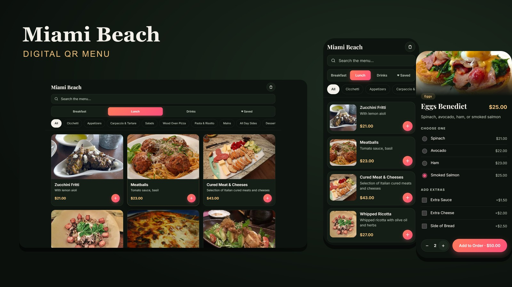

**Live demo:** https://gudagit.github.io/restaurant-menu-app/
**Source:** https://github.com/Gudagit/restaurant-menu-app

This page explains what the project is, what I did, how I worked, and how I checked the result. A shorter overview is in the [README](README.md).

## Summary

A mobile-first digital menu for an Italian restaurant. Guests scan a QR code, search 103 dishes, choose variants and extras, save favourites and build an order with a running total. It is plain HTML, CSS and JavaScript with no framework and no dependencies, and it works from a 280 px folded phone to a 2560 px monitor.

## How this was made

This is a learning project. I built it together with an AI coding assistant, and I want that to be clear.

**What the AI assistant helped with:** writing and refactoring code, suggesting layouts and checks, and automating tests and image processing.

**What I did:**
- Decided what the product should do and how it should look, and reviewed each change.
- Chose the features: search, variants and extras, cart, favourites, sharing.
- Edited the menu: removed and moved dishes, and removed third-party brand names.
- Chose the photos and checked every licence (details below).
- Tested the result on different screen sizes and in the browser, and reported what to fix.
- Decided what to publish and what to keep private, and published the site on GitHub Pages.

I can explain how each part of the code works.

## Goal

Build a realistic, polished front end for a restaurant QR menu that feels like a real product, without a framework or backend, and that stays fast on a phone.

## Features

1. **Live search and filtering** by section (Breakfast, Lunch, Drinks) and category.
2. **Dish detail** with variants that have their own prices, and extras that depend on the dish type.
3. **Cart** with quick add, a floating order bar, a bottom-sheet drawer, quantity controls, a service charge, and state that survives reloads.
4. **Favourites** with their own tab, and native sharing with a clipboard fallback.
5. **Installable** to the home screen through a web app manifest.

## Screens

<table>
  <tr>
    <td>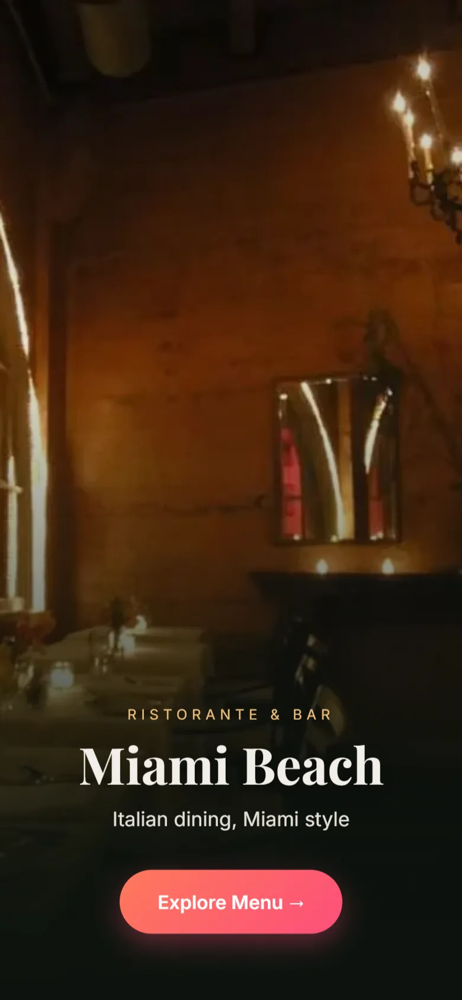</td>
    <td>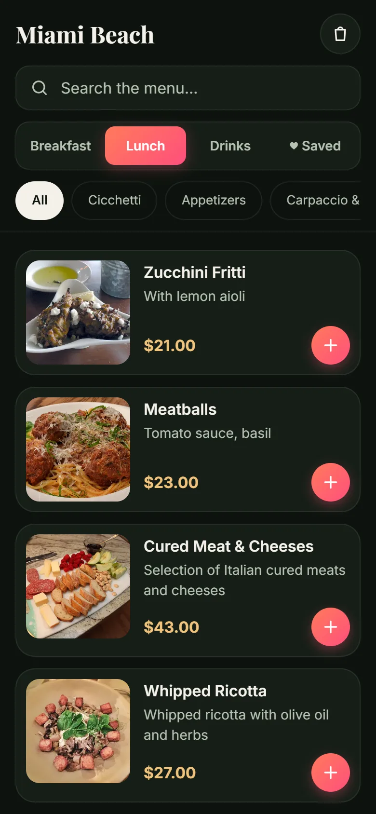</td>
    <td>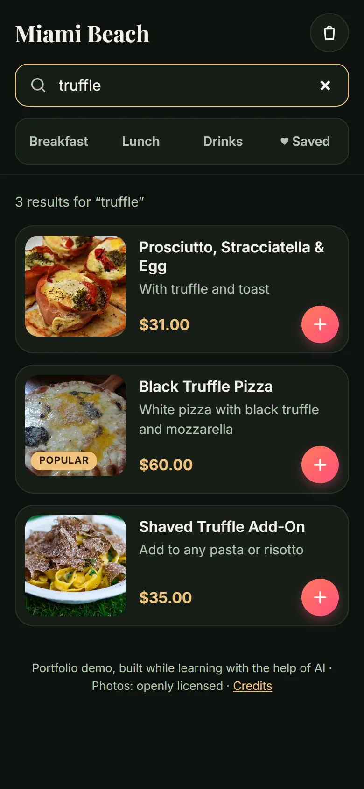</td>
  </tr>
  <tr>
    <td align="center">Welcome</td>
    <td align="center">Menu</td>
    <td align="center">Live search</td>
  </tr>
  <tr>
    <td>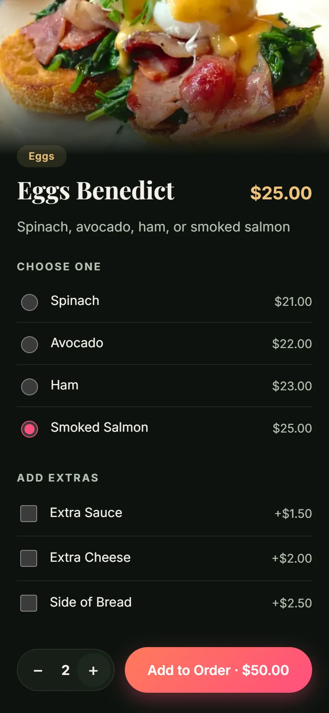</td>
    <td>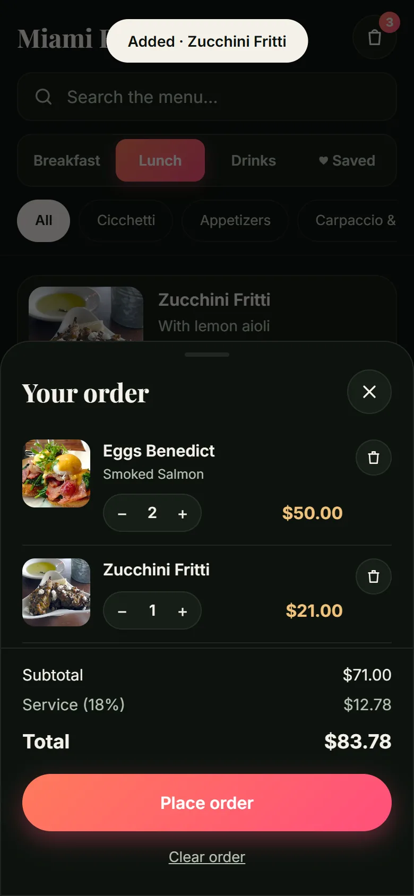</td>
    <td>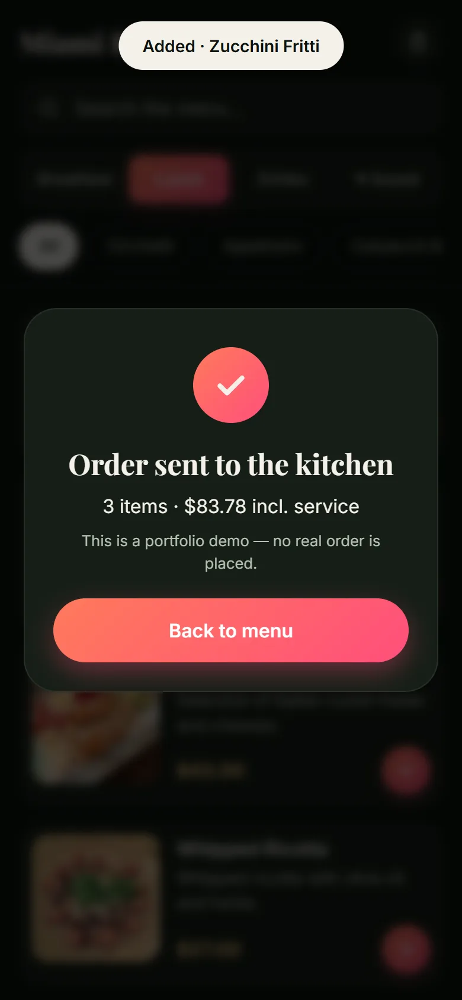</td>
  </tr>
  <tr>
    <td align="center">Variants and extras</td>
    <td align="center">Order drawer</td>
    <td align="center">Confirmation (demo)</td>
  </tr>
</table>

**Tablet and desktop**

  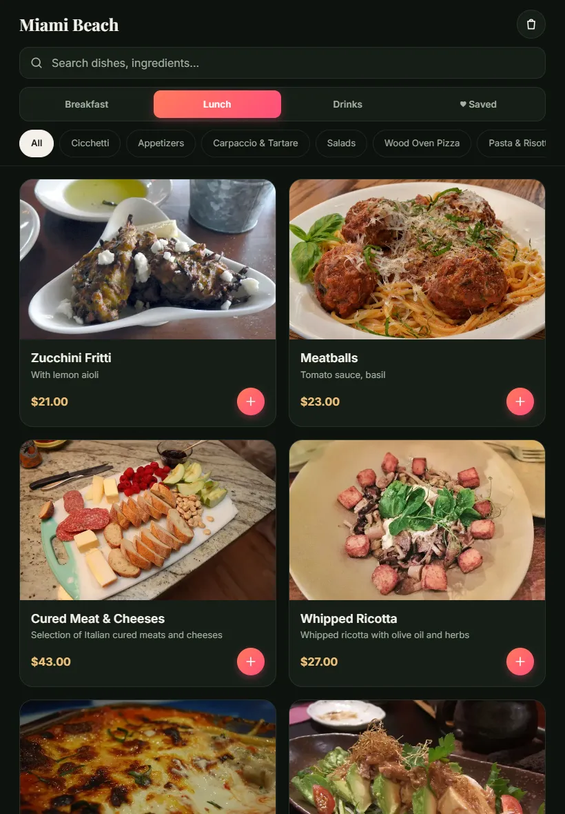
  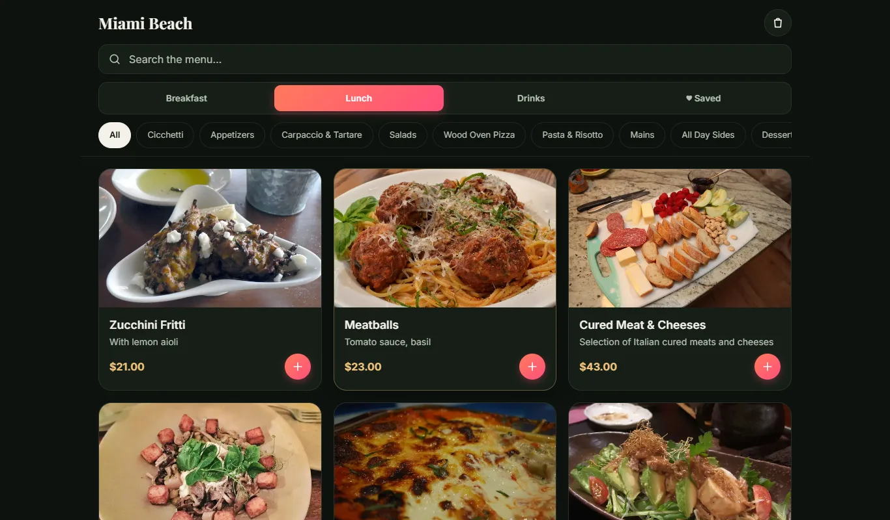

  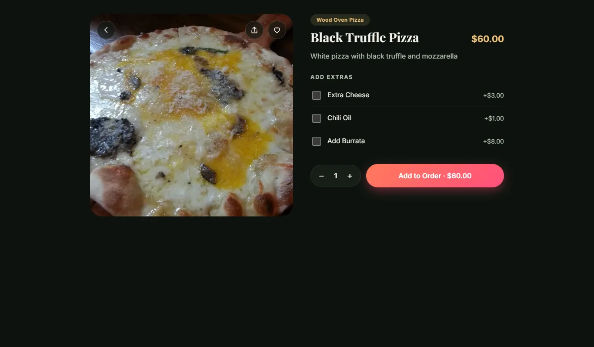
  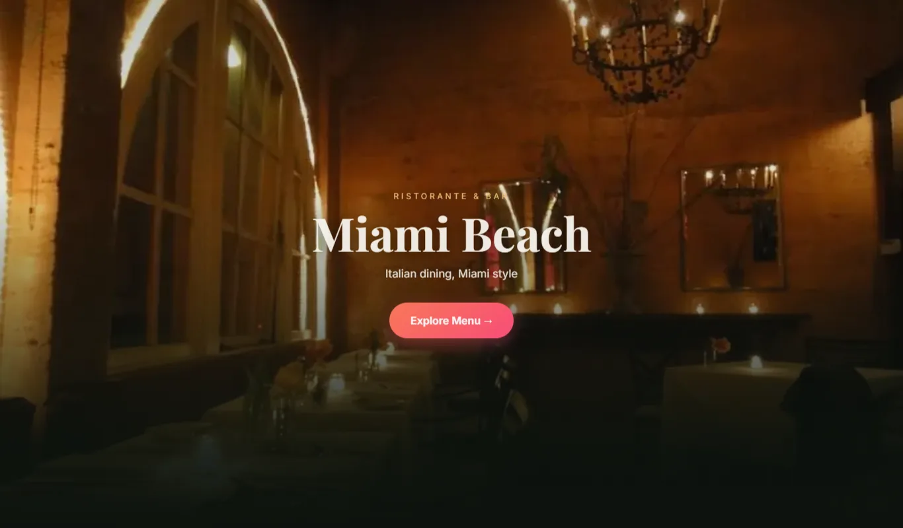

## Decisions and problems solved

- **The same dish with different choices.** "Eggs Benedict with ham" and "with salmon" must be separate cart lines. Each line has a key made from the dish, the variant and the sorted extras, so identical choices merge and different ones stay apart.
- **Heavy images.** The photos weighed about 9 MB. I resized them to 800 px and converted them to WebP (about 4 MB), lazy-loaded them, and used fixed aspect ratios so the page does not jump while loading (layout shift is 0).
- **One layout for many devices.** The CSS is mobile-first: compact rows on phones, two columns on tablets, three to five on laptops and large monitors, text that scales up on big screens, safe-area padding for notches, and hover effects turned off on touch screens.
- **Safe rendering.** Menu text is inserted with `textContent` instead of `innerHTML`, so menu data can never inject markup.
- **Licensing.** I audited every photo. 27 had no source recorded and one had a licence that forbids changes. I replaced them. All 104 photos now use CC BY, CC BY-SA or CC0 licences and are credited in [images/CREDITS.md](images/CREDITS.md). Third-party brand names were removed from the menu.
- **Accessibility issue found by testing.** Lighthouse reported a missing `main` landmark. I fixed it and accessibility went from 98 to 100.

## Results

| Measure | Result |
|---|---|
| Lighthouse, mobile | Performance 92, Accessibility 100, Best Practices 100, SEO 100 |
| Lighthouse, desktop | Performance 99, Accessibility 100, Best Practices 100, SEO 100 |
| Layout shift / blocking time | 0 / 0 ms |
| Photo weight | about 9 MB down to about 4 MB |
| Screen sizes checked | 11, from 280 px to 2560 px, no horizontal scrolling and no console errors |
| Dependencies | none |
| Menu | 103 dishes in 15 categories |

Measured on a local server with Lighthouse's simulated mobile throttling, so treat the numbers as a snapshot.

## What I would add next

A backend so orders reach the kitchen, a staff screen, an admin page to edit the menu, more languages, and payments.

## Licences

Code is MIT ([LICENSE](LICENSE)). Fonts are Inter and Playfair Display (SIL Open Font License). Photos are openly licensed stock images and are not photos of a real restaurant. The restaurant name and menu are placeholders, and "Place order" is a demo that sends nothing.
