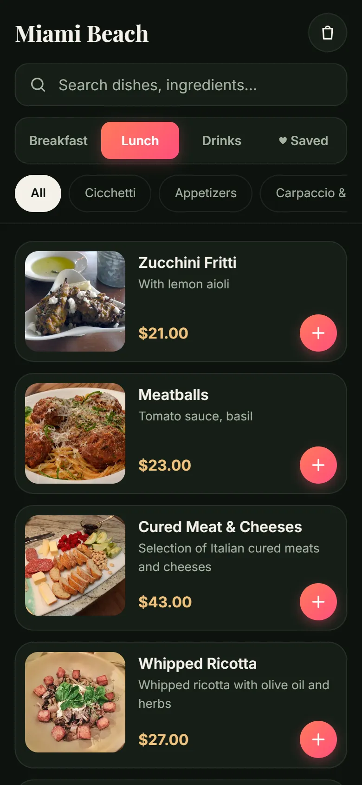
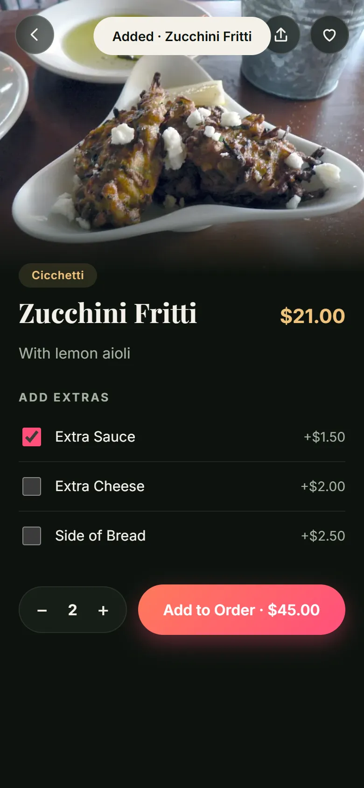
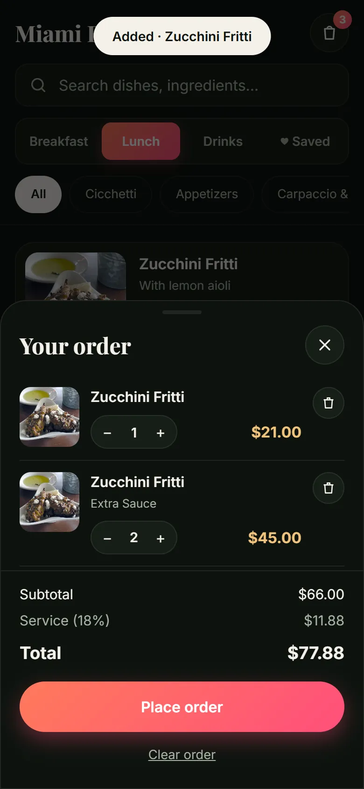

# Miami Beach · Digital QR Menu

A mobile-first digital menu for an Italian restaurant. Guests scan a QR code, browse the menu, customise dishes and build an order, all from their phone. Built with plain HTML, CSS and JavaScript, with no framework and no build step.

**Live demo:** https://gudagit.github.io/restaurant-menu-app/

<p align="center">
  
  
  
  
</p>

## Features

- **Browse** by section (Breakfast / Lunch / Drinks) and category, with live search across names, descriptions and categories.
- **Dish detail** with a large photo, variants (e.g. Eggs Benedict), and extras that depend on the dish type (coffee gets extra shot and oat milk, pizza gets chili oil and so on).
- **Order cart:** quick add, floating order bar, bottom-sheet drawer with quantity controls, service charge and total. The cart persists across reloads via `localStorage`.
- **Favourites** saved on the device and shown in their own tab, plus a **Share** button that uses the Web Share API with a clipboard fallback.
- **Responsive:** phone, tablet and desktop layouts, safe-area support for notched phones, touch-friendly targets and `prefers-reduced-motion` support.
- **Accessible:** semantic buttons, ARIA labels, visible focus states, keyboard navigation and Escape to close.
- **Installable:** includes a web app manifest, so it can be added to a phone's home screen.
- **Fast:** images are resized WebP (about 4 MB for the whole menu), lazy-loaded with a shimmer placeholder.

## Run locally

No install needed. Serve the folder with any static server:

```bash
npx http-server -p 5500
# then open http://localhost:5500
```

## Project structure

```
index.html        page markup
styles.css        design tokens, layout and responsive rules
script.js         rendering, search, cart, favourites
menu-data.js      the whole menu as data (edit this to change dishes and prices)
images/           optimised dish photos + CREDITS.md
screenshots/      images used in this README
manifest.webmanifest
```

To add a dish, add an entry to `menu-data.js`. Optional fields: `options` for variants with their own prices, and `popular: true` for the "Popular" badge.

## Licensing and credits

- **Code:** MIT, see [LICENSE](LICENSE). Everything in the HTML, CSS and JavaScript was written for this project, and no third-party code or libraries are used.
- **Fonts:** [Inter](https://fonts.google.com/specimen/Inter) and [Playfair Display](https://fonts.google.com/specimen/Playfair+Display), both SIL Open Font License, loaded from Google Fonts.
- **Photos:** openly licensed stock images (CC BY, CC BY-SA, CC0) found through Openverse. Every photo is credited in [images/CREDITS.md](images/CREDITS.md). They are not photos of the restaurant’s real dishes.
- **Demo only:** "Place order" shows a confirmation but does not send anything anywhere. The restaurant name and menu are placeholders made up for this demo.
